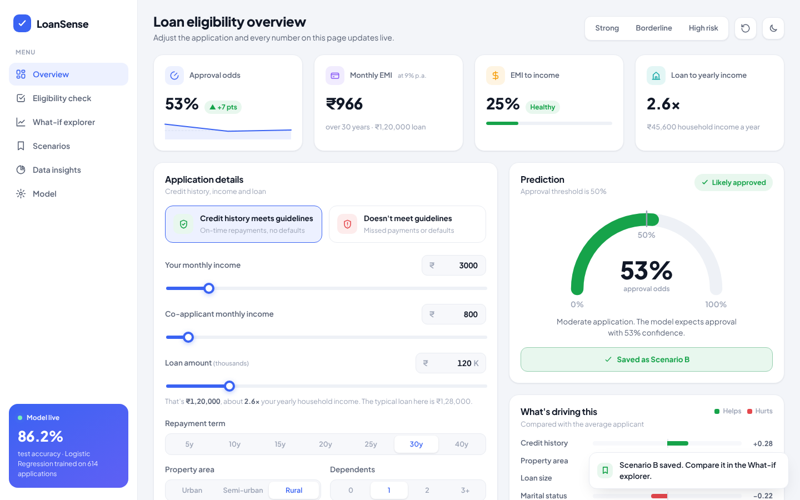
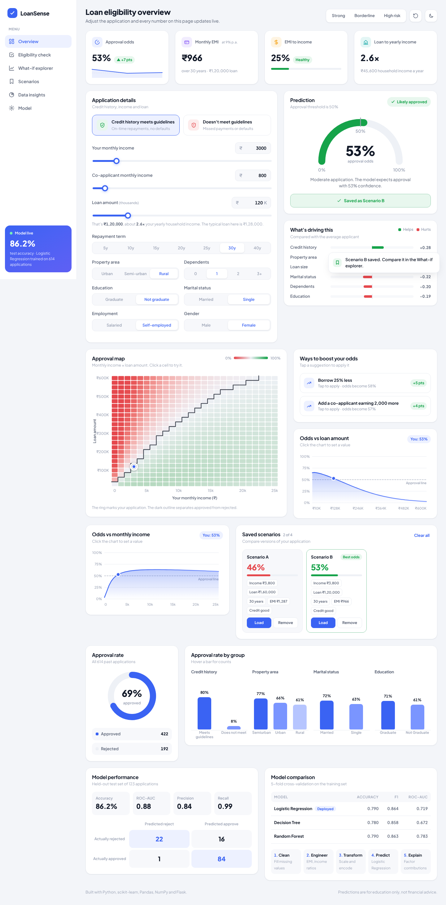
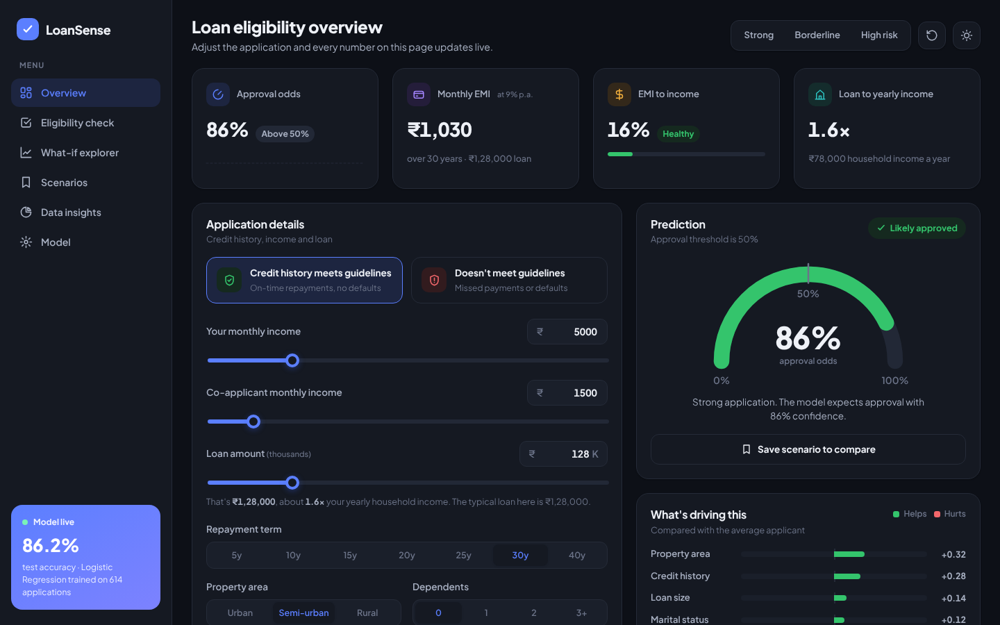
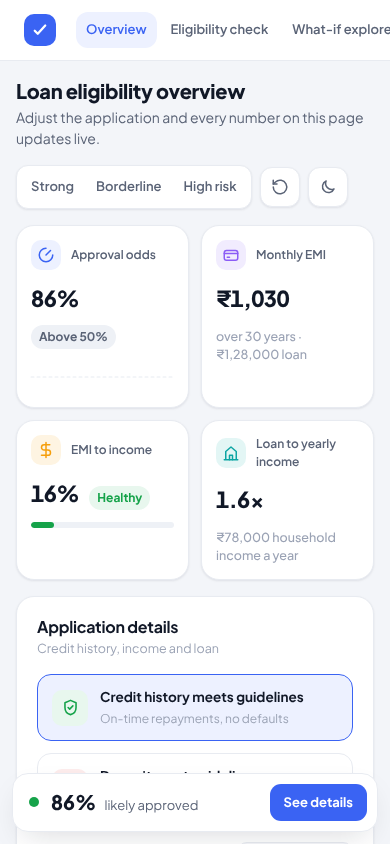

# Loan Eligibility Prediction Using Machine Learning

An end-to-end system that predicts whether a loan application is likely to be approved.
It covers data preprocessing (missing value handling, feature scaling, categorical encoding),
a Logistic Regression model for credit risk classification, and a Flask web app that gives
real-time approval predictions.

**Tech stack:** Python · Scikit-learn · Flask · Pandas · NumPy



## The app: LoanSense

A light, SaaS-style dashboard (sidebar, KPI tiles and chart cards) served by Flask, with dark mode built in:

- **Live prediction.** Sliders and toggles update the approval odds instantly, with an animated gauge and verdict.
- **Explainable results.** "What's driving this" shows how much each factor (credit history, income, loan size, property area and more) helps or hurts, using the Logistic Regression coefficients.
- **What-if coaching.** "Ways to boost your odds" tests changes such as borrowing less or adding a co-applicant, and applies them in one tap.
- **What-if explorer.** A clickable approval map (income × loan amount) outlines where the decision flips, and two odds curves show how the loan amount and income move your chances. Hover to read the odds, and click to try a value.
- **Scenario comparison.** Save up to four scenarios and compare them side by side, with the best odds highlighted.
- **KPI tiles.** Approval odds with a live trend line, monthly EMI, EMI-to-income health and loan-to-income ratio, all updating as you type.
- **Feedback that feels alive.** A confetti burst when an application crosses into approval, toasts for every action, and a sticky result bar on mobile.
- **Affordability check.** Monthly EMI at 9% p.a. and the EMI-to-income ratio, colour-coded by risk.
- **Data insights.** Approval rates by credit history, property area, marital status and education from the training data.
- **Model transparency.** Pipeline walkthrough, test-set metrics, confusion matrix and model comparison.
- Example profiles, dark and light themes, mobile layout, keyboard accessible, respects reduced-motion settings.



| Dark theme | Mobile |
|---|---|
|  |  |

## Results

Evaluated on a stratified 20% held-out test set (123 applications):

| Metric | Score |
|---|---|
| Accuracy | 86.2% |
| ROC-AUC | 0.88 |
| F1 (approved class) | 0.91 |
| Precision / Recall | 0.84 / 0.99 |

5-fold cross-validation on the training set, comparing Logistic Regression with tree baselines:

| Model | Accuracy | F1 | ROC-AUC |
|---|---|---|---|
| **Logistic Regression** (deployed) | 0.790 | 0.864 | 0.719 |
| Decision Tree (depth 4) | 0.780 | 0.858 | 0.672 |
| Random Forest | 0.790 | 0.863 | 0.783 |

Logistic Regression matches the more complex models on accuracy and F1 while staying fully
interpretable, which matters for credit decisions. Its coefficients show **credit history**
is by far the strongest factor, followed by property area, marital status and education.
Full numbers are in [`reports/metrics.json`](reports/metrics.json).

## Dataset

[`data/loan_data.csv`](data/loan_data.csv) is the public Loan Prediction dataset
(614 applications, 68.7% approved). Columns:

| Column | Description |
|---|---|
| Gender, Married, Dependents, Education, Self_Employed | Applicant profile |
| ApplicantIncome, CoapplicantIncome | Monthly income |
| LoanAmount | Loan amount in thousands |
| Loan_Amount_Term | Term in months |
| Credit_History | 1 if credit history meets guidelines, else 0 |
| Property_Area | Urban, Semiurban or Rural |
| Loan_Status | Target: Y (approved) or N |

Seven columns have missing values (Credit_History has 50, Self_Employed 32, LoanAmount 22).

## How it works

1. **Preprocessing** ([`src/preprocess.py`](src/preprocess.py))
   - Missing values: median for numbers, most frequent value for categories
   - Feature engineering: log of total income and loan amount, EMI (monthly instalment),
     balance income after EMI, and loan-to-income ratio
   - Feature scaling with `StandardScaler`
   - Categorical encoding with `OneHotEncoder`
   - Everything is wrapped in one scikit-learn `Pipeline`, so the web app applies exactly
     the same transforms as training
2. **Training** ([`src/train.py`](src/train.py))
   - Stratified 80/20 train/test split
   - 5-fold cross-validation against Decision Tree and Random Forest baselines
   - `GridSearchCV` to tune the regularisation strength `C` and class weighting
   - Final model refit on all data and saved to `models/loan_model.joblib`
3. **Prediction** ([`src/predict.py`](src/predict.py)) loads the saved pipeline and returns
   the decision and approval probability for one application
4. **Explanation** ([`src/predict.py`](src/predict.py)) breaks the log-odds into per-factor contributions
   compared with the average applicant, and scores what-if scenarios for improvement tips
5. **Web app** ([`app.py`](app.py), [`templates/`](templates/index.html), [`static/`](static/app.js))
   serves the LoanSense interface and a JSON API

## Project structure

```
loan-eligibility-prediction/
├── app.py                  Flask web app (form + JSON API)
├── data/loan_data.csv      Dataset
├── models/loan_model.joblib Trained pipeline
├── reports/
│   ├── metrics.json        Evaluation results
│   └── app_screenshot.png
├── src/
│   ├── preprocess.py       Cleaning, feature engineering, preprocessing pipeline
│   ├── train.py            Training, model comparison, tuning, evaluation
│   ├── predict.py          Prediction, explanations and what-if tips (also a CLI)
│   └── insights.py         Dataset statistics for the insights section
├── static/
│   ├── style.css           Design system (dark and light themes)
│   └── app.js              Live prediction, gauge, charts and interactions
├── templates/index.html
├── tests/test_app.py
└── requirements.txt
```

## Getting started

```bash
python -m venv .venv
source .venv/bin/activate        # Windows: .venv\Scripts\activate
pip install -r requirements.txt

python -m src.train              # train and evaluate (prints a full report)
python app.py                    # open http://127.0.0.1:5000
```

A trained model is already included, so `python app.py` works straight away.

### Command line

```bash
python -m src.predict --income 5000 --coincome 1500 --loan 128 --credit 1
# Approved (approval probability 85.6%), followed by top factors and tips
```

### JSON API

```bash
curl -X POST http://127.0.0.1:5000/api/predict \
  -H "Content-Type: application/json" \
  -d '{"ApplicantIncome": 5000, "LoanAmount": 128, "Credit_History": 1}'
```

The response includes the decision, approval probability, per-factor `factors`, improvement
`suggestions` and an `affordability` block. Add `?explain=0` for just the decision and probability.
`POST /api/landscape` takes the same fields and returns the approval-map grid and the two what-if curves.
`GET /api/insights` returns the dataset statistics and model metrics.

`ApplicantIncome`, `LoanAmount` and `Credit_History` are required; other fields fall back
to sensible defaults.

### Tests

```bash
python -m pytest
```

## Possible extensions

- Deploy on Render or Railway with `gunicorn app:app`
- Add SHAP explanations so each prediction shows why it was approved or rejected
- Build a Power BI dashboard on the dataset to show approval rates by segment
